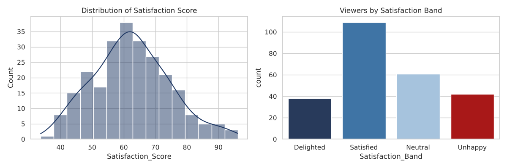
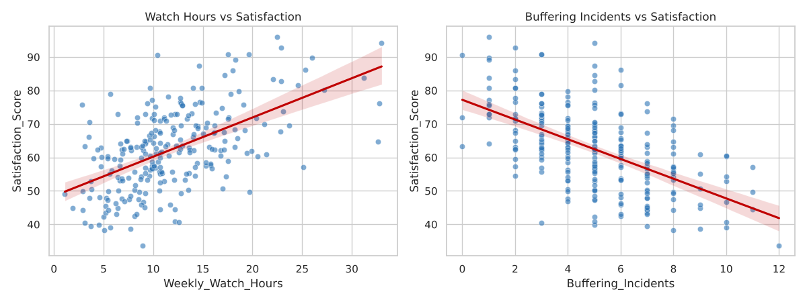
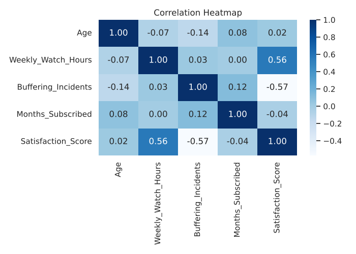
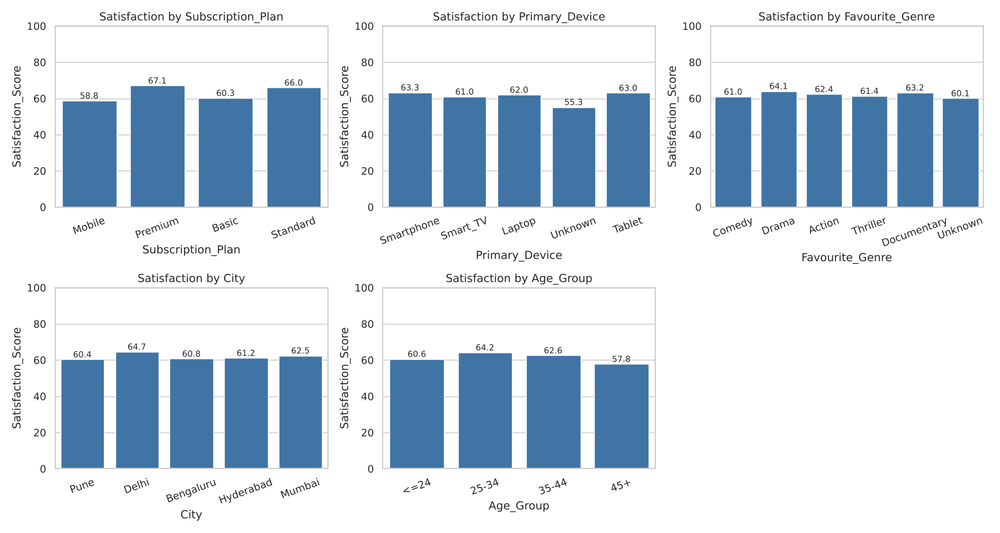
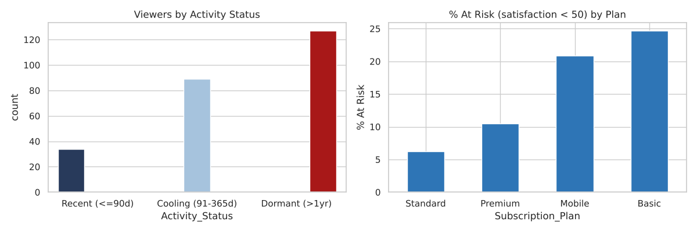

# OTT Viewing Analysis (Sample Data Analyst Project)

A beginner-friendly data analysis project for **B.Tech 1st Year – Data Analyst** learners.
It analyses what drives viewer satisfaction on an OTT (streaming) platform using Python, pandas, matplotlib and seaborn.

> The dataset is **synthetic** (computer-generated). It contains no real viewer data.

## Business problem
The platform wants to understand which factors influence viewer satisfaction and engagement, so the product and retention teams can fix problems and win back unhappy viewers early.

## Questions answered
1. What does overall engagement and satisfaction look like?
2. Do watch hours and buffering affect satisfaction?
3. Does satisfaction differ by plan, device, genre, city or age group?
4. Which viewers are at risk (satisfaction below 50), and how recently were viewers active?

## Dataset
`data/raw/ott_viewing_data.csv` – 255 rows, 11 columns (Viewer_ID, City, Subscription_Plan, Primary_Device, Favourite_Genre, Age, Weekly_Watch_Hours, Buffering_Incidents, Months_Subscribed, Last_Active_Date, Satisfaction_Score).
The raw file has missing values, 5 duplicate rows, messy City text (`delhi`, `DELHI`, ` pune`) and impossible Age values (-24 and 212), so you can practise cleaning.

## Project structure
```
OTT_Viewing_Analysis/
├── data/
│   ├── raw/ott_viewing_data.csv
│   └── processed/ott_viewing_clean.csv
├── notebooks/ott_viewing_analysis.ipynb
├── images/                  (charts saved by the notebook)
├── requirements.txt
├── .gitignore
└── README.md
```

## How to run
```bash
git clone https://github.com/<your-username>/ott-viewing-analysis.git
cd ott-viewing-analysis
pip install -r requirements.txt
jupyter notebook notebooks/ott_viewing_analysis.ipynb
```

## Steps followed
1. Load and inspect data  2. Clean data (duplicates, text, impossible ages, missing values)  3. Create new columns (Days_Since_Active, Satisfaction_Band, Activity_Status, Age_Group, Buffering_Band, At_Risk)  4. Exploratory analysis with charts  5. Insights and recommendations

## Key findings (from this dataset)
- Average satisfaction is about 62 out of 100, and viewers watch about 12 hours per week.
- Buffering has a moderate negative correlation with satisfaction (about -0.57): viewers with 0–2 incidents average 74, while those with 9+ average 49.
- Weekly watch hours correlate positively with satisfaction (about 0.56).
- Premium (67) and Standard (66) plans are more satisfied than Basic (60) and Mobile (59).
- About 17% of viewers are "At Risk" (satisfaction below 50); they average 7 buffering incidents against 4.6 for others.
- Genre, city and device differences are small. Age 45+ is lowest (58) but the group is small, so treat it with caution.

## Charts






## Limitations
- Correlation is not causation: this shows association only.
- `Last_Active_Date` spans about two years, so activity cut-offs (90 days, 1 year) are a judgement call.
- Missing values were filled with the median (numbers) or `Unknown` (categories); only 5 rows are affected per column.

## Tools
Python 3 · pandas · NumPy · matplotlib · seaborn · Jupyter Notebook · Git and GitHub

## Author
Shivangi tiwari – B.Tech 1st Year (2026B01010449)
